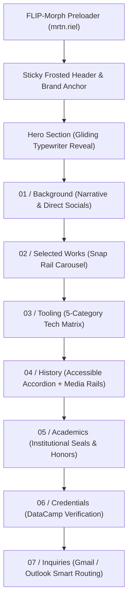

# Gabriel Martin R. Manalo — Portfolio

> An institutional, typography-first **Editorial Minimal Design** personal portfolio engineered with semantic HTML5, modern CSS3 custom properties, and modular Vanilla JavaScript (ES6+).

---

## ✦ Table of Contents

- [Overview](#-overview)
- [Design Philosophy & Aesthetic Manifesto](#-design-philosophy--aesthetic-manifesto)
- [Design Tokens & Color Palette](#-design-tokens--color-palette)
- [Typography & Spatial System](#-typography--spatial-system)
- [Key Features & Engineering Architecture](#-key-features--engineering-architecture)
  - [1. FLIP-Morph Preloader](#1-flip-morph-preloader)
  - [2. Scroll-Synchronized Typewriter Engine](#2-scroll-synchronized-typewriter-engine)
  - [3. Horizontal Snap Rail Projects Carousel](#3-horizontal-snap-rail-projects-carousel)
  - [4. Interactive Experience Accordion & Galleries](#4-interactive-experience-accordion--galleries)
  - [5. Categorized Tech Stack Matrix](#5-categorized-tech-stack-matrix)
  - [6. Academic History & Verified Credentials](#6-academic-history--verified-credentials)
  - [7. Smart Dual-Channel Email Routing](#7-smart-dual-channel-email-routing)
  - [8. Mobile Navigation Drawer & Accessibility](#8-mobile-navigation-drawer--accessibility)
- [Featured Works & Case Studies](#-featured-works--case-studies)
- [Leadership & Experience](#-leadership--experience)
- [Technology Matrix](#-technology-matrix)
- [Project Structure](#-project-structure)
- [Local Development & Usage](#-local-development--usage)
- [Performance & Accessibility Standards](#-performance--accessibility-standards)
- [Author & Contact Channels](#-author--contact-channels)

---

## ✦ Overview

This repository hosts the official personal web portfolio of **Gabriel Martin R. Manalo** (`mrtn.riel`), a Bachelor of Science in Information Technology (BSIT) student and President's Lister at the **Polytechnic University of the Philippines (PUP)**.

Rejecting common web design tropes—such as neon gradients, heavy drop shadows, rounded pill buttons, and gratuitous decorations—this portfolio is built from the ground up on the principles of **Swiss International Typographic Style**, high-end venture editorial layouts, and razor-sharp architectural geometry.

Every visual hierarchy is established strictly through **type scale, typographic weight, hairline rules (1px), and deliberate whitespace**.

---

## 🏛️ Design Philosophy & Aesthetic Manifesto

The portfolio adheres to the **Editorial Minimal Design** philosophy:

1. **Typography Does the Heavy Lifting**  
   Driven entirely by the neo-grotesque font **Inter**. Headlines span massive display sizes with tight letter tracking (`-0.03em`), paired with justified editorial body text.
2. **Warmth Over Clinical Whites**  
   A warm cream paper canvas (`#f6f2ea`) paired with deep near-black ink (`#15130f`) evokes tactile printed broadsheets and archival paper rather than cold computer displays.
3. **Sharp, Utilitarian Geometry**  
   Strict adherence to razor-sharp zero border radii (`border-radius: 0`). Buttons, input boxes, image frames, and tags maintain crisp rectangular forms.
4. **Hairline Structural Architecture**  
   Dividers, card boundaries, and ledger rows use subtle 1px hairline rules (`#d9d4c9`). Borders define structural layout rather than decorative framing.
5. **Space is the Luxury**  
   Expansive layout padding (`clamp(20px, 5vw, 80px)`), unified left-edge alignment, and deliberate vertical rhythm yield a calm, commanding presence.
6. **Authentic Mechanical Accents**  
   System glyphs (`→`, `←`, `↑`, `•`) replace bloated third-party icon fonts for structural UI, while clean, inline SVG vector graphics represent technical brands and communication channels.

---

## 🎨 Design Tokens & Color Palette

The site uses native CSS Custom Properties (`:root`) with a high-contrast paper-and-ink palette:

| Token | Hex Value | Role & Usage |
|:---|:---|:---|
| `--bg` | `#f6f2ea` | **Canvas Paper**: Warm off-white foundation reducing eye fatigue. |
| `--ink` | `#15130f` | **Primary Ink**: Near-black warm ink for high-priority typography, solid buttons, and borders. |
| `--ink-muted` | `#55524b` | **Editorial Body**: Balanced medium tone for comfortable reading across long paragraphs. |
| `--ink-subtle` | `#7a766d` | **Metadata & Labels**: Neutral stone tone for section counters, dates, and category tags. |
| `--line` | `#d9d4c9` | **Hairline Rules**: 1px structural dividing lines across cards, grids, and boundaries. |
| `--card-bg` | `#ede8df` | **Parchment Surface**: Tonal step between paper and hairline used for media frames and tags. |

### CSS Variables Excerpt

```css
:root {
    /* Color Palette */
    --bg: #f6f2ea;
    --ink: #15130f;
    --ink-muted: #55524b;
    --ink-subtle: #7a766d;
    --line: #d9d4c9;
    --card-bg: #ede8df;

    /* Typography */
    --font-sans: "Inter", "Helvetica Neue", Arial, system-ui, sans-serif;

    /* Spatial Dimensions */
    --container: 1400px;
    --gutter: clamp(20px, 5vw, 80px);
    --radius: 0;
    --header-height: 80px;

    /* Motion Physics */
    --ease-out: cubic-bezier(0.16, 1, 0.3, 1);
    --duration-micro: 130ms;
    --duration-base: 240ms;
    --duration-reveal: 640ms;
}
```

---

## 🔤 Typography & Spatial System

- **Hero Title**: `clamp(2.25rem, 5.5vw + 0.5rem, 4.75rem)` with tight tracking (`-0.03em`) and dense leading (`1.08`).
- **Section Headers (`h2`)**: `clamp(2.25rem, 4vw, 3.5rem)` with uppercase numbered editorial markers (`01 / Background`, `02 / Selected Works`, etc.).
- **Narrative Leads**: `clamp(1.25rem, 2.5vw, 1.45rem)` in dark ink to orient the reader.
- **Editorial Body**: `1.0625rem` rendered with justified inter-word spacing (`text-justify: inter-word; hyphens: auto`).
- **Metadata & Monospace Labels**: Uppercase micro-typography with open tracking (`letter-spacing: 0.04em - 0.08em`) balancing large display titles.

---

## ⚡ Key Features & Engineering Architecture



### 1. FLIP-Morph Preloader
- Displays an editorial typewriter animation spelling out `mrtn.riel`.
- Executes a FLIP (First, Last, Invert, Play) transition calculating the exact viewport bounding rectangle delta between the preloader center and the header brand logo, smoothly gliding and scaling into place.
- Honors `prefers-reduced-motion` and incorporates graceful timeout fallbacks.

### 2. Scroll-Synchronized Typewriter Engine
- Utilizes `IntersectionObserver` to trigger typewriter heading generation and center-out gliding origin reveals as sections enter the viewport.
- Smoothly preserves layout stability through fixed-height typographical reserves, avoiding layout shifts (CLS).

### 3. Horizontal Snap Rail Projects Carousel
- Custom scroll controller (`scroll-snap-type: x mandatory`) with hidden scrollbars for clean presentation.
- Dynamic metric calculation adjusting for card widths, gap metrics, and container padding.
- Interactive utilitarian navigation arrows (`←`, `→`) with real-time scroll boundary detection and automatic disabled state management.

### 4. Interactive Experience Accordion & Galleries
- Expandable leadership and work experience panels adhering to WAI-ARIA standards (`aria-expanded`, `aria-controls`, `role="region"`).
- Smooth CSS height transitions with zero layout thrashing.
- Each role contains an internal horizontal photo gallery with dedicated scroll navigation controls and touch-swipe support.

### 5. Categorized Tech Stack Matrix
- Structured across 5 core specializations: Frontend Core, Backend Core, Databases, Developer Tools, and AI Tools.
- High-contrast SVG vector emblems with subtle hover lifting physics and descriptive domain summaries.

### 6. Academic History & Verified Credentials
- Institutional credentials featuring university seals (PUP, St. Patrick School of Quezon City).
- Certificate preview cards with direct links to verified statements of accomplishment (DataCamp SQL certification).

### 7. Smart Dual-Channel Email Routing
- Desktop users clicking email links are routed directly into web compose windows for **Gmail** (`mail.google.com/mail/?view=cm...`) or **Outlook 365** (`outlook.office.com/mail/deeplink/compose...`).
- Mobile devices automatically fallback to native system email handlers via `mailto:` URI schemes with pre-populated subjects and greeting bodies.

### 8. Mobile Navigation Drawer & Accessibility
- Full-screen mobile navigation drawer with frosted background blur, accessible toggle (`aria-expanded`), and auto-closing on link navigation.
- Accessible keyboard skip links (`.skip-link`) pointing to `#main-content`.
- High-contrast visible focus rings (`:focus-visible`) for complete keyboard navigation.

---

## 💼 Featured Works & Case Studies

| Project | Category | Technology Stack | Deliverables & Links |
|:---|:---|:---|:---|
| **SALN Submission Portal** | Full-Stack Web Application | Python (Flask), MySQL, JavaScript, HTML5, CSS3 | Secure public sector asset and liability declaration portal with role-based access. <br>• [Source Code](https://github.com/mrtnriel) |
| **PUP Room Booking (PUPWESTO)** | UI/UX & HCI Architecture | Figma, Wireframing, User Research, Usability Testing | University facility reservation system addressing scheduling conflicts and room utilization. <br>• [Figma Interactive Prototype](https://www.figma.com/proto/gqwc5tSAWlLeSLLpxWD74U/High-Fidelity-Wireframe--Group-4-?node-id=273-3882&p=f&viewport=97%2C97%2C0.21&t=aOiHw4stNh1wiOF5-1&scaling=scale-down&content-scaling=fixed&starting-point-node-id=273%3A3882&page-id=251%3A2134) |
| **Koso Lifewear** | Front-End Development | React, Vite, Tailwind CSS, TypeScript | Minimalist Japanese-inspired apparel e-commerce interface with fluid spring physics. <br>• [Live Deployment](https://koso-lifewear.vercel.app/) |
| **Axis Studio** | 3D Front-End Customizer | React 19, Three.js, Web Audio API, Vite, Tailwind CSS | Interactive 3D mechanical keyboard configurator with dynamic materials and realistic acoustic feedback. <br>• [Live Deployment](https://axis-studio-seven.vercel.app/) |

---

## 🎖️ Leadership & Experience

- **AWS Cloud Club PUP** — *Associate Lead for the Web Development Department (Skill Builder Department)* `[Sep 2024 – Present]`  
  Directing technical web curriculum, mentoring student developers in modern web standards, and leading hands-on cloud development workshops.
- **Cisco NetConnect PUP** — *Membership Lead (Relations Department)* `[Sep 2024 – Present]`  
  Spearheading member onboarding, technical community engagement, and cross-departmental coordination for networking initiatives.
- **Microsoft Campus Club PUP** — *Marketing Communications Officer* `[Sep 2024 – Present]`  
  Crafting technical campaign copy, announcements, and visual assets for developer events and workshops.

---

## 🛠️ Technology Matrix

```
┌─────────────────┬─────────────────────────────────────────────────────────┐
│ Domain          │ Technologies & Tools                                    │
├─────────────────┼─────────────────────────────────────────────────────────┤
│ Frontend Core   │ HTML5, CSS3 (Custom Properties), JavaScript (ES6+),     │
│                 │ React, Vite, Tailwind CSS, Three.js                     │
├─────────────────┼─────────────────────────────────────────────────────────┤
│ Backend Core    │ Node.js, Python (Flask), Java, C++                      │
├─────────────────┼─────────────────────────────────────────────────────────┤
│ Databases       │ MySQL, PostgreSQL, TiDB Cloud (Distributed SQL), MongoDB│
├─────────────────┼─────────────────────────────────────────────────────────┤
│ Developer Tools │ Git, GitHub, VS Code, Vercel, Figma                     │
├─────────────────┼─────────────────────────────────────────────────────────┤
│ AI & Workflows  │ Antigravity CLI, Google Gemini, Anthropic Claude,       │
│                 │ OpenAI ChatGPT                                          │
└─────────────────┴─────────────────────────────────────────────────────────┘
```

---

## 📂 Project Structure

```
.
├── index.html                           # Semantic single-page HTML5 architecture
├── README.md                            # Project documentation & engineering manual
├── css/
│   └── style.css                        # Design tokens, responsive typography, and layouts
├── js/
│   └── script.js                        # Preloader, FLIP morph, carousels, accordions, and routing
├── skill/
│   └── editorial-minimal-design.md      # Aesthetic guidelines and design system tokens
└── assets/
    ├── certificates/                    # Statements of accomplishment (PDF & WebP)
    │   ├── Introduction to SQL - DataCamp.webp
    │   └── SQL certificate.pdf
    ├── cv/                              # Downloadable Curriculum Vitae
    │   └── manalo_cv.pdf
    ├── experience/                      # Leadership photo assets and galleries
    │   └── placeholders/
    │       ├── aws/                     # AWS Cloud Club event imagery
    │       ├── cisco/                   # Cisco NetConnect event imagery
    │       └── mcc/                     # Microsoft Campus Club event imagery
    ├── favicon/                         # Multi-resolution favicons and site icons
    ├── logos/                           # Institutional university and school seals
    │   ├── pup.webp
    │   └── st-patrick.png
    ├── me/                              # Author portrait photography
    │   └── Profile.jpg
    ├── proj/                            # Project preview mockups and screenshots
    │   ├── axis-studio.webp
    │   ├── figma.png
    │   ├── koso-preview.webp
    │   └── SALN System.webp
    └── tech/                            # Pure SVG brand vectors for the tech stack
        ├── antigravity.svg, cplusplus.svg, css.svg, html.svg,
        ├── java.svg, javascript.svg, mongodb.svg, mysql.svg,
        ├── nodejs.svg, postgresql.svg, python.svg, react.svg,
        └── tailwindcss.svg, tidb.svg, typescript.svg, vercel.svg, ...
```

---

## 🚀 Local Development & Usage

Because this portfolio is built exclusively with standard Web platform technologies (Vanilla HTML, CSS, and JavaScript), **no build step, bundler, or Node package manager installation is required**.

### Quick Start

1. **Clone the repository:**
   ```bash
   git clone https://github.com/mrtnriel/Midterm-Project.git
   cd Midterm-Project
   ```

2. **Launch with any local static HTTP server:**

   *Using Python 3:*
   ```bash
   python -m http.server 8000
   ```

   *Using Node.js (`npx`):*
   ```bash
   npx serve .
   ```

   *Using VS Code Live Server extension:*
   Right-click `index.html` and select **"Open with Live Server"**.

3. **Open in browser:**  
   Navigate to `http://localhost:8000` (or the port specified by your server).

---

## ♿ Performance & Accessibility Standards

- **Semantic Landmarks**: Strict use of `<header>`, `<nav>`, `<main>`, `<section>`, `<article>`, `<time>`, and `<footer>`.
- **Keyboard Navigation**: Complete focus management with a visible skip link (`#main-content`), distinct `:focus-visible` outlines, and full keyboard control for carousels and accordions.
- **ARIA Compliance**: Proper implementation of `aria-expanded`, `aria-controls`, `aria-label`, and `aria-hidden` attributes for assistive technologies.
- **Motion Preferences**: Full support for `@media (prefers-reduced-motion: reduce)`, instantly nullifying transforms, animations, and transitions for sensitive users.
- **Image Optimization**: WebP and SVG format prioritization, explicit dimensional attributes (`width`, `height`), and native lazy loading (`loading="lazy"`).

---

## 👤 Author & Contact Channels

**Gabriel Martin R. Manalo** (`mrtn.riel`)  
*BS Information Technology Student — Polytechnic University of the Philippines*

- **Primary Email (Gmail)**: [martinramirezasdw@gmail.com](mailto:martinramirezasdw@gmail.com)
- **Institutional Email (Outlook)**: [gabrielrmanalo@iskolarngbayan.pup.edu.ph](mailto:gabrielrmanalo@iskolarngbayan.pup.edu.ph)
- **GitHub**: [@mrtnriel](https://github.com/mrtnriel)
- **LinkedIn**: [Gabriel Martin Manalo](https://www.linkedin.com/in/gabriel-martin-manalo-411a0134a/)
- **Curriculum Vitae**: [View CV (PDF)](assets/cv/manalo_cv.pdf)
